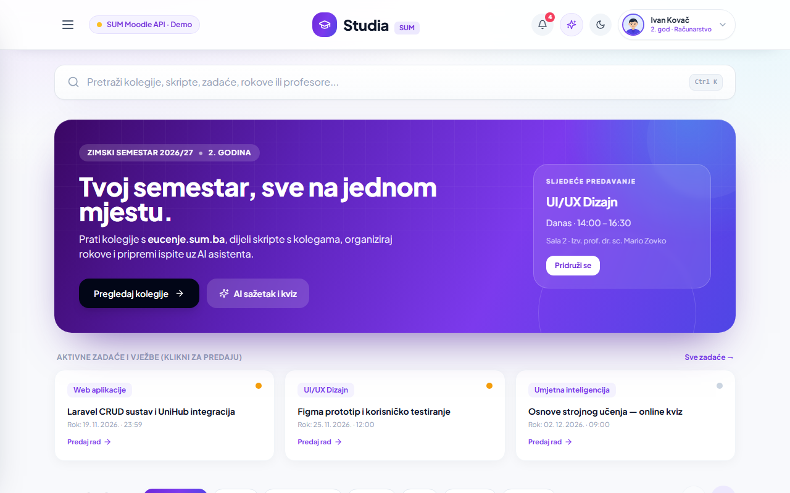
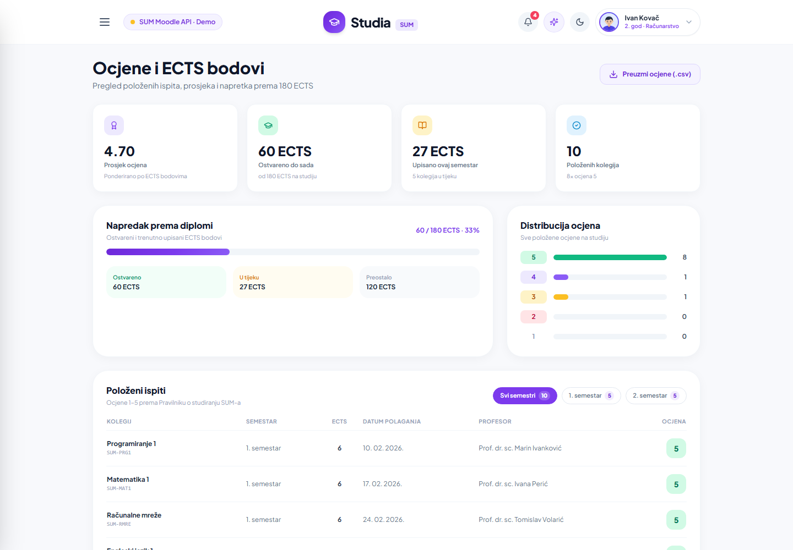
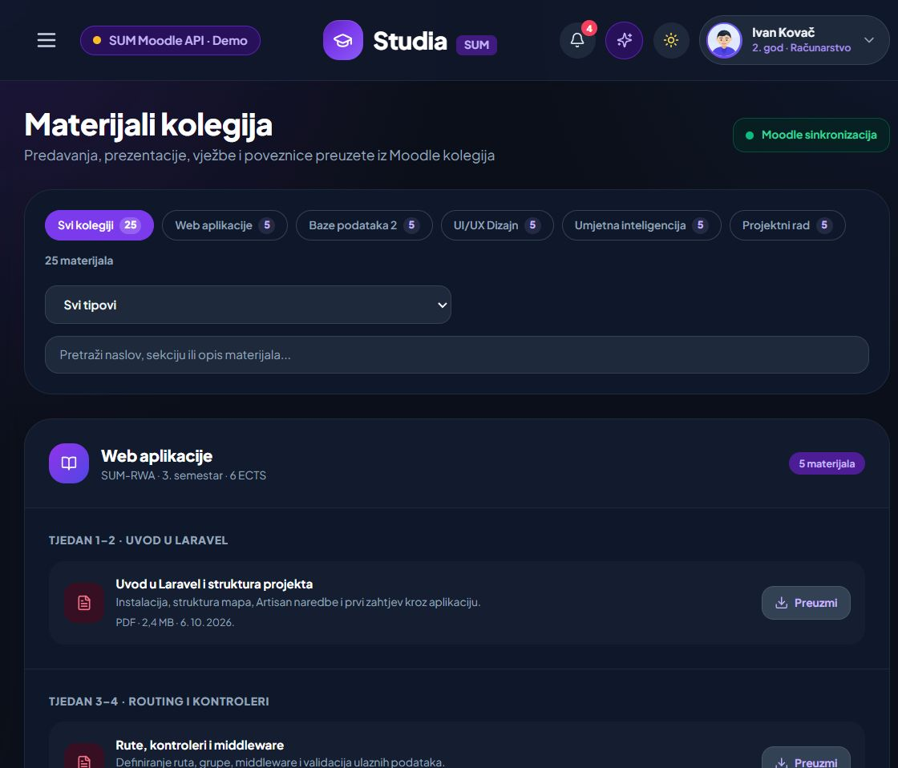

# Studia — studentski portal, demo i integracijska osnova

[](https://github.com/Max55-lab/studia-moodle/actions/workflows/deploy.yml)
[](https://github.com/Max55-lab/studia-moodle/actions/workflows/ci.yml)

**Studia** je responzivni studentski portal (demo) inspiriran SUM e-učenjem. Novi **Studia 3** redizajn uklanja višak informacija s početne stranice: jedan sljedeći rok, tri ključna broja i kolegiji su odmah vidljivi, a planer, tablice, statistika i grafikoni skriveni su u sklopivom bloku „Arhiva detalja“.

**Live demo:** <https://max55-lab.github.io/studia-moodle/>



> Demo koristi isključivo izmišljene podatke i ne provodi stvarnu autentikaciju. Live demo na GitHub Pages servira statički sadržaj (`index.html` + `assets/`). Prikazani korisnik je generički `user` — u repozitoriju nema osobnih podataka ni tokena.

## O projektu (za predaju)

- **Cilj:** objediniti svakodnevne akademske informacije (kolegiji, ocjene, materijali, rokovi, raspored) na jednom preglednom mjestu i studentima smanjiti vrijeme traženja podataka kroz više e-kolegija.
- **Korisnici:** studenti SUM-a; nastavnici i administratori koriste nativnu Moodle temu `theme_studia`.
- **Ključne funkcionalnosti:** nadzorna ploča s fokusom na sljedeći rok, pretraga i filtriranje, osobni planer s punim CRUD-om, favoriti kolegija, grafikoni napretka, izvoz podataka, svijetli/tamni način i eksperimentalna live sinkronizacija.
- **Tim:** dva studenta — imena i individualne doprinose unijeti prije predaje. Podjela posla: (1) dizajn i frontend sučelje; (2) podatkovni sloj, integracija i testiranje. Oba člana samostalno brane svoj doprinos.

## Tehnologije

- **Frontend:** HTML, CSS (Tailwind + vlastiti CSS), vanilla JavaScript bez frameworka.
- **Integracija:** Node.js demo proxy za Moodle i Moodle 4.5 Boost child tema (`theme_studia`, PHP/SCSS).
- **Pohrana:** `localStorage` za demo stanje planera, favorita i postavki; stvarni akademski podaci ostaju u Moodleu prema ADR-001.
- **Alati za kvalitetu:** Playwright (E2E), Lighthouse (pristupačnost), Node provjere, GitHub Actions i GitHub Pages.

## Korištenje AI alata

AI je korišten za planiranje, generiranje i objašnjavanje koda, razvoj sučelja, otklanjanje pogrešaka, testiranje i dokumentiranje.

- **Claude (u OpenCode okruženju):** redizajn sučelja, CSS animacije, CRUD planera, E2E testovi, provjere pristupačnosti i dokumentacija.
- Ostale alate koje je tim koristio (npr. ChatGPT, Copilot) navesti ovdje prije predaje.

Svi AI-generirani dijelovi ručno su pregledani i provjereni (`node scripts/check.mjs`, Playwright, Lighthouse) te prilagođeni postojećoj arhitekturi. U javni repozitorij ne unose se stvarne lozinke, tokeni ni osobni podaci.

Obvezna pravila za rad AI alatova i developera nalaze se u [`AGENTS.md`](AGENTS.md) (kratki pokazivač za Cursor je u `.cursorrules`).

## Dizajn — Studia 3

- **Novi vizualni sustav:** tamna navigacijska traka, svijetla radna površina, tamni hero s jednim sljedećim rokom i narančastim signalnim akcentom uz violetni primarni (tamni način koristi istu strukturu).
- **Jedan fokus:** nadzorna ploča prikazuje samo sljedeći rok, prosjek, ECTS i broj aktivnih zadaća. Sve ostalo je u `<details id="dashboard-more">`.
- **Manje buke:** bočna navigacija ima 7 stavki, bez dupliciranih badgeova; filtari, brze veze i kartice koriste nove, ali jednostavne komponente.
- **Pokret bez buke:** postepeni ulazak sadržaja, suptilne hover reakcije, animirani brojači i pozdrav prema dobu dana — bez novih podataka i uz poštovanje `prefers-reduced-motion`.
- **Bez novih ovisnosti:** promjena je isključivo u CSS-u i strukturi nadzorne ploče; svi ID-ovi i testni hookovi su očuvani.
- **Isti jezik u temi:** `theme/studia/scss/post.scss` koristi istu paletu i akcent, bez novih endpointa ili tokena.

## Smjer integracije — theme-first

Prema preporuci mentora, **produkcijska integracija sa SUM-om je `theme_studia`**, a ne vanjski REST proxy. Razlog: autentifikacija, autorizacija i stvarni izvori podataka već postoje u Moodleu 4.5. Dodavanje vlastitog API sloja donosilo bi nove tokene, endpointa i sigurnosne rizike bez stvarne potrebe.

- ✅ **Produkcija:** [`theme/studia/`](theme/studia/README.md) — nativna Moodle tema (Moodle prijava, uloge, ovlasti, baza, user preferences, `require_sesskey()`).
- 🧪 **Demo/laboratorij:** statički portal i `server/moodle-proxy.js` — isključivo s izmišljenim podacima; **ne koristiti s pravim studentskim podacima ni tokenom**.

Odluka je detaljno obrazložena u [`docs/DECISIONS.md`](docs/DECISIONS.md) (ADR-001).

## Što je uključeno u repozitorij

- **Web portal (statički demo):** `index.html`, `assets/` — glavni preglednik demo aplikacije.
- **Moodle tema (produkcijski smjer):** `theme/studia/` — Boost child tema za Moodle 4.5 (nativna Moodle autentikacija/ovlasti, user preferences, SCSS/templejti).
- **Moodle proxy primjer (samo demo):** `server/` — Node.js proxy za eksperimentalnu live sinkronizaciju bez izlaganja tokena u pregledniku. Nije zamjena za Moodleov sigurnosni model.
- **Integracijska i projektna dokumentacija:** `docs/` (uključujući `DECISIONS.md`), `studia.config.example.js`, `CONTRIBUTING.md`, `SECURITY.md`, `CHANGELOG.md`, `LICENSE`.
- **Dizajn artefakt za 24-modularnu Student SaaS Platformu:** [`docs/ARTITEKTURA.md`](docs/ARTITEKTURA.md) (monorepo, mape modula, sigurnosni model, faze) i [`docs/schema.sql`](docs/schema.sql) (67 tablica, RLS, RBAC, pgvector i generički seed). To je zaseban nacrt — ne mijenja theme-first produkcijski smjer iz ADR-001.

## Ključne značajke portala

- **Pregledi:** nadzorna ploča, profil, inbox, kolegiji/UniHub, ocjene i ECTS, materijali, obavijesti, zadaće, raspored, Meet sobe, AI demo asistent.
- **Planer i favoriti:** osobni zadaci s rokom i punim CRUD-om (dodavanje, uređivanje, završavanje, brisanje) te označavanje kolegija favoritima uz filtar „Favoriti“.
- **Vizualizacije:** kretanje kumulativnog prosjeka ocjena, distribucija ocjena i napredak po kolegijima (inline SVG/CSS, bez vanjskih biblioteka).
- **UX:** svijetli/tamni način, responzivan prikaz (desktop/tablet/mobilno), pretraga, filtri, modali, toast poruke, izvoz (npr. `.ics`, CSV) i demo preuzimanja.
- **Demo stanje:** dio postavki i radnji sprema se lokalno u pregledniku (`localStorage`) isključivo za potrebe demonstracije.
- **Moodle adapter (demo):** demo način i eksperimentalni live način preko backend proxyja (token ostaje na poslužitelju). Live način nije za produkciju — vidi ADR-001.

| Ocjene i ECTS | Materijali kolegija |
| --- | --- |
|  |  |

## Brzi početak

### Pokretanje lokalno (preporučeno)

```bash
# iz korijena repozitorija
python -m http.server 5500 --bind 127.0.0.1
```

Otvori: <http://127.0.0.1:5500/>

> Moguće je otvoriti i `index.html` izravno, ali lokalni server je preporučen zbog dosljednog učitavanja resursa.

### CSS (Tailwind)

Generirani CSS je već uključen (`assets/css/tailwind.css`). Ako mijenjaš klase/stilove koji ovise o Tailwind buildu:

```bash
npm install
npm run build:css
# razvoj: npm run watch:css
```

### Osnovne provjere

```bash
npm run check
```

Pokreće osnovne provjere (JSON, sintaksa JS datoteka, PHP sintaksa Moodle teme ako je PHP dostupan, prisutnost ključnih datoteka, obavezni HTML ID-ovi, duplicirani ID-ovi i redoslijed učitavanja scriptova). Ista skripta i zaseban PHP lint pokreću se i u CI-ju.

### Browser smoke-testovi (Playwright)

```bash
npm install
npm run test:e2e:install   # samo prvi put: preuzima Chromium
npm run test:e2e
```

Testovi u `tests/e2e/portal.spec.js` pokrivaju učitavanje nadzorne ploče, navigaciju, planer, favorite, tamni način i demo → live → demo sinkronizaciju preko mock proxyja. Playwright sam pokreće statički server (`scripts/static-server.js`, port `4173`) i mock proxy (port `8788`), pa nije potrebno ručno ih paliti. Isti testovi idu i u CI (uz `npm ci` i `npx playwright install --with-deps chromium`).

## Konfiguracija i integracija

Portal je pripremljen za prilagodbu kroz runtime konfiguraciju i dokumentirane integracijske točke.

- **Konfiguracija:** `assets/js/config.js` (učitava se prije ostalih aplikacijskih skripti)
- **Primjer:** `studia.config.example.js`
- **Vodič integracije:** [`docs/INTEGRATION.md`](docs/INTEGRATION.md)
- **Podatkovni model:** [`docs/DATA_MODEL.md`](docs/DATA_MODEL.md)
- **Arhitektura:** [`docs/ARCHITECTURE.md`](docs/ARCHITECTURE.md)

Primjer (inline override prije `config.js`):

```html
<script>
  window.STUDIA_CONFIG = {
    branding: { productName: "Studia", institutionShort: "SUM" },
    features: { aiAssistant: false },
    links: { moodlePortal: "https://eucenje.sum.ba/moodle/" }
  };
</script>
<script src="assets/js/config.js" defer></script>
```

Dostupan je i globalni namespace `window.Studia` (konfiguracija, lifecycle hookovi/eventi i osnovni API nakon inicijalizacije).

## Moodle integracija

### Demo način
- Zadano aktivan, bez mrežnih zahtjeva.
- Koristi ugrađene demo podatke za prikaz sinkronizacije i sažetaka.

### Live način (preko proxyja) — eksperimentalno, samo za demo

> **Nije za produkciju.** Proxy nema korisničku prijavu ni autorizaciju po ulogama. Za stvarni SUM koristi `theme_studia` (ADR-001).

- Front-end šalje zahtjev proxy servisu; proxy koristi Moodle Web Service token i vraća `summary` + normalizirani `data` (kolegiji, ocjene, materijali, zadaće, obavijesti).
- `assets/js/live-data.js` preslikava taj payload u modele portala i osvježava cijeli UI — kartice, ocjene i grafikoni tada koriste stvarne Moodle podatke.
- **Token se ne smije nalaziti u pregledniku, `localStorage` ili front-end kodu.** Live studentski podaci također ostaju samo u memoriji.
- Bez pravog tokena možeš isprobati tok s mock proxyjem: `node scripts/mock-moodle-proxy.js` → upiši `http://127.0.0.1:8788` u modalu.

Primjer pokretanja proxyja (Node 18+):

```bash
cd server
# postavi varijable okruženja (primjer)
# MOODLE_TOKEN=... MOODLE_URL=https://eucenje.sum.ba/moodle ALLOWED_ORIGIN=https://max55-lab.github.io
node moodle-proxy.js
```

Detalji: [`server/README.md`](server/README.md)

## Moodle tema (`theme/studia`)

U repozitoriju se nalazi i Moodle 4.5 Boost child tema:
- nativna Moodle autentikacija i autorizacija (bez vlastite prijave),
- prikaz prilagođen Studia vizualnom identitetu,
- korisničke preference (npr. način prikaza) kroz Moodle mehanizme.

Upute za instalaciju i postavke: [`theme/studia/README.md`](theme/studia/README.md)

## Struktura projekta (sažetak)

```text
.
├── index.html                  # statički portal (live demo ulazna točka)
├── assets/
│   ├── css/                    # stilovi (tailwind build + custom)
│   ├── js/                     # config, data, core, live-data, render, views, charts, adapteri, app
│   ├── img/, fonts/, vendor/   # resursi
├── docs/                       # integracija, podatkovni model, arhitektura, privatnost
├── server/                     # Moodle proxy primjer
├── theme/studia/               # Moodle 4.5 tema
├── .github/workflows/          # CI i deploy
├── studia.config.example.js     # primjer integracijske konfiguracije
└── README.md
```

## Kvaliteta, sigurnost i privatnost

- **Pristupačnost:** semantika, fokus stanja, tipkovnička podrška, ARIA oznake i poštivanje `prefers-reduced-motion` (gdje je primjenjivo).
- **Sigurnost:** bez izlaganja tajni u klijentu; integracije trebaju poslužiteljsku autentikaciju/autorizaciju i obradu podataka. Vidi [`SECURITY.md`](SECURITY.md).
- **Privatnost:** demo koristi izmišljene podatke; lokalna pohrana služi samo za demo stanje/preferencije. Vidi [`docs/PRIVACY.md`](docs/PRIVACY.md).
- **CI:** osnovne provjere sintakse i valjanosti konfiguracije (`.github/workflows/ci.yml`).

## Deploy

- **GitHub Pages:** workflow `.github/workflows/deploy.yml` objavljuje `index.html` i `assets/` na svaki push na `main` (ili ručno pokretanje).
- **Repo-only sadržaj:** dokumentacija, tema, proxy i konfiguracijski primjeri nalaze se u repozitoriju i nisu nužno dio statičkog Pages artefakta.

## Doprinos i licenca

- Smjernice za doprinos: [`CONTRIBUTING.md`](CONTRIBUTING.md)
- Evidencija promjena: [`CHANGELOG.md`](CHANGELOG.md)
- Licenca: [`LICENSE`](LICENSE)

## Napomene i ograničenja

- Aplikacija je u zadanoj konfiguraciji **demo** (bez baze, bez stvarnog korisničkog računa, bez produkcijskih garancija).
- Za produkcijsku upotrebu potrebno je implementirati odgovarajuće backend sustave, sigurnosne kontrole, upravljanje podacima i usklađenost s pravilima/propisima ciljnog okruženja.
- Dio akademskih podataka u stvarnim sustavima može dolaziti iz više izvora (npr. Moodle + IS/SIS), pa integracija zahtijeva mapiranje i usklađivanje podatkovnog modela.